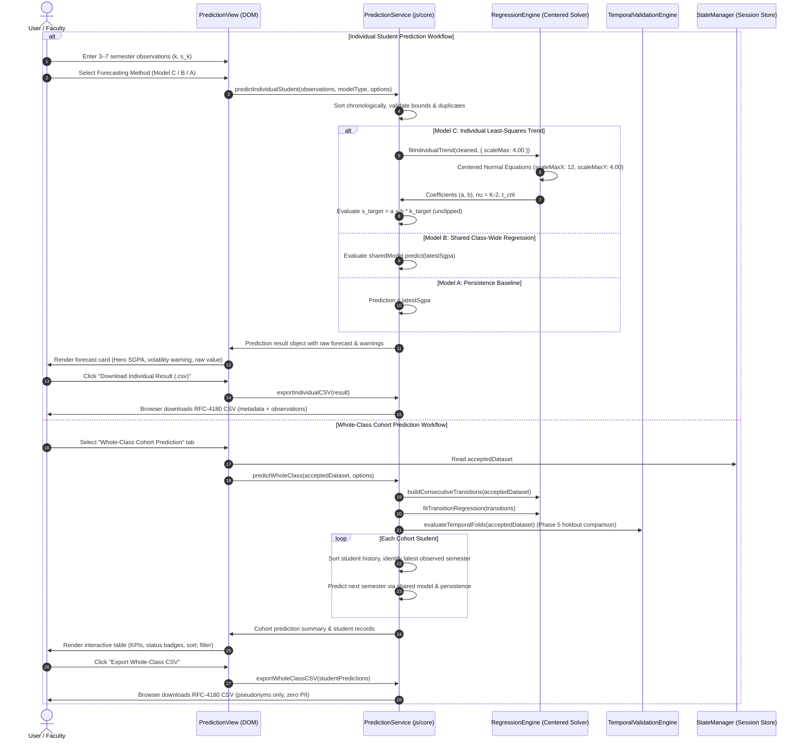
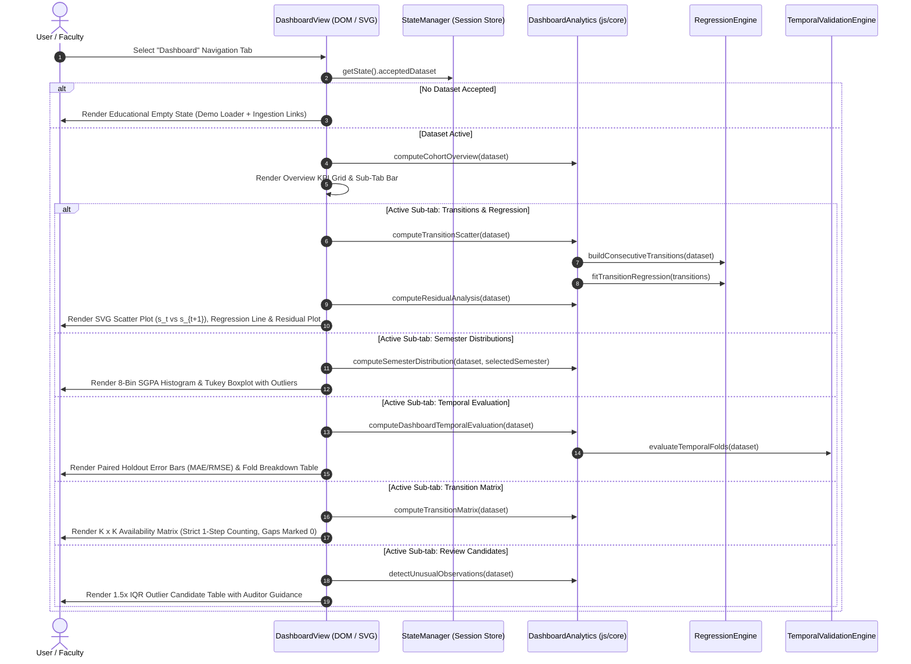
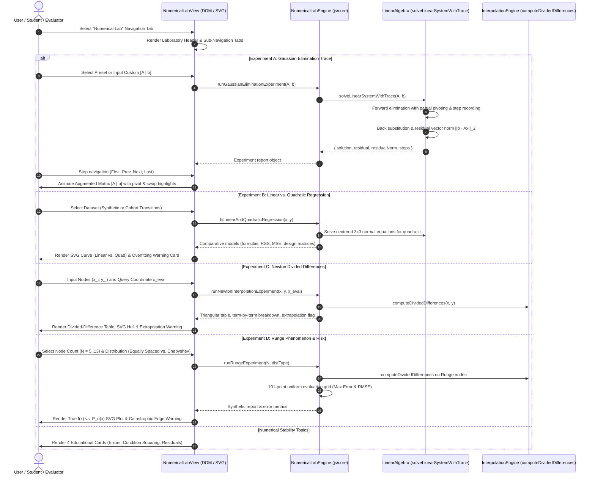

# System Architecture — ClassPredict

> **Document ID**: DOC-ARCH-001  
> **Status**: Approved & Implemented (Phase 9 Numerical Methods Laboratory Complete)  
> **Lifecycle State**: Fully Implemented & Tested (Laboratory, Dashboard, Prediction, OCR, Evaluation, & Core Engine Complete)  
> **Last Updated**: October 2026

---

## 1. Architectural Philosophy & Principles

ClassPredict is designed under four core engineering principles:

1. **Pedagogical Transparency**: Numerical algorithms must be implemented from first principles in clean, readable code. Opaque "black-box" libraries are deliberately excluded so that the student can inspect, trace, and defend every matrix operation during academic examination.
2. **Absolute Privacy via Client-Side Locality**: Academic transcripts contain sensitive student records. By executing all data ingestion, OCR extraction, and numerical modeling entirely within the client's browser runtime, zero student data ever traverses a network or rests on a remote server.
3. **Architectural Parsimony**: Unnecessary architectural complexity (e.g., separate microservices, container orchestrators, external databases) is rejected in favor of a lean, decoupled, browser-native modular architecture.
4. **Decoupled Engine Design**: The core numerical computation engine (`linear_algebra.js`, `regression_engine.js`, `numerical_lab.js`) and dataset validator (`data_validator.js`) have zero dependencies on the browser DOM or UI framework, enabling isolated unit testing via a headless Node.js test harness.

---

## 2. Technology Stack Evaluation & Runtime Clarifications

| Architectural Layer | Selected Technology | Evaluated Alternatives | Rationale & Requirements |
| :--- | :--- | :--- | :--- |
| **Runtime Environment** | Modern Web Browser (V8 / SpiderMonkey) + Local Static Server | Python Backend (FastAPI / Flask) | Eliminates Python backend setup; guarantees 100% data privacy by keeping all processing in client memory. **Note**: A local HTTP server (`python -m http.server` or `npx serve`) is required to serve ES6 modules without CORS errors. |
| **Logic & Core Engine** | Vanilla ES6+ JavaScript Modules | TypeScript / Python NumPy | Standard browser ES6 modules require zero transpilation overhead; pure mathematical code illustrates numerical algorithms clearly for viva defense. |
| **Styling & Design System**| Custom Vanilla CSS3 Design Tokens | TailwindCSS / Bootstrap | Complete control over obsidian/crimson aesthetic; eliminates build-step bloat and large CSS runtime dependencies. |
| **Document Processing (PDF)**| PDF.js (Mozilla) | Server-side `pypdf` / `pdf2image` | Renders multi-page university result sheets locally on an HTML5 canvas without server upload. |
| **Optical Character Recognition**| Tesseract.js (WebAssembly / Web Worker) | Cloud Vision API / Python Tesseract | Executes OCR locally inside a sandboxed Web Worker; static language data (`eng.traineddata`) is loaded as a read-only asset. |
| **Data Persistence** | Volatile In-Memory Session State | PostgreSQL / SQLite / IndexedDB | Ephemeral memory ensures that student grades are automatically purged when the tab is closed, enforcing data protection. |
| **Test Harness** | Node.js Test Runner (Headless) | PyTest / Jest | Lightweight, zero-config test execution for pure JavaScript numerical algorithms and matrix solvers. **Node.js is required only for developer testing**. |

---

## 3. High-Level System Architecture Diagram

```mermaid
graph TB
    subgraph Browser_Client["Client-Side Browser Runtime (ClassPredict)"]
        subgraph UI_Layer["Presentation & Interaction Layer (UI/UX)"]
            DashboardUI["Dashboard View<br/>(Metrics & Trends)"]
            PredictUI["Prediction View<br/>(Raw Output & Warnings)"]
            OCRUILayer["OCR Canvas Crop &<br/>Key Reconciliation Table"]
            LabUI["Numerical Methods<br/>Educational Lab View (Phase 9)"]
        end

        subgraph Core_Services["Core Application Services"]
            StateManager["Session State Manager<br/>(In-Memory Store)"]
            DataValidator["Dataset Validation &<br/>Sanitization Engine"]
            OCRService["OCR Pipeline Controller<br/>(PDF.js + Tesseract.js Worker)"]
        end

        subgraph Numerical_Core["Numerical Computation Core (Pure ES6, No DOM)"]
            LinearAlgebra["Linear Algebra Subsystem<br/>(Gaussian Elim with Scale-Aware Pivoting & Trace)"]
            RegressionEngine["Least-Squares Regression<br/>(Predictor Centering & Variance Pre-Check)"]
            InterpolationEngine["Interpolation Subsystem<br/>(Newton Divided Differences)"]
            TemporalValidator["Temporal Validation Engine<br/>(Rolling-Origin Backtester)"]
            DashboardAnalytics["Dashboard Analytics Engine<br/>(Distributions, Scatter, Residuals, Outliers)"]
            NumericalLab["Educational Numerical Lab Engine<br/>(Traces, Quadratic Fits, Divided Diff, Runge)"]
        end
    end

    %% Ingestion flows
    UserCSV[/"User Long-Format CSV Upload"/] -->|Raw Text| DataValidator
    UserPDF[/"Result Sheet (PDF/Image)"/] -->|Render Canvas| OCRUILayer
    OCRUILayer -->|Cropped Sub-Bitmap| OCRService
    OCRService -->|Pure Extraction & Reconciliation| OCREngine["OCR & Geometric Engine<br/>(js/core/ocr_engine.js)"]
    OCREngine -->|Candidate Review Rows| OCRUILayer
    OCRUILayer -->|Reconciled Rows| StateManager
    StateManager -->|Atomic Validate & Merge| DataValidator
    
    DataValidator -->|Clean Dataset Records| StateManager
    StateManager -->|Historical Transitions| RegressionEngine
    StateManager -->|Student Histories| PredictUI
    StateManager -->|Cohort Dataset| DashboardAnalytics
    DashboardAnalytics -->|Distributions, Scatter, Residuals, Matrix| DashboardUI

    %% Numerical computation flows
    RegressionEngine -->|Form Centered Equations| LinearAlgebra
    LinearAlgebra -->|Coefficients [a, b]| RegressionEngine
    RegressionEngine -->|Raw Prediction & Uncertainty| PredictUI
    RegressionEngine -->|Temporal Folds Evaluation| TemporalValidator
    TemporalValidator -->|MAE / RMSE vs Baseline| DashboardAnalytics
    InterpolationEngine -->|Divided Difference Polynomial| LabUI
```

---

## 4. End-to-End Data Flows & Key Reconciliation

### 4.1 Privacy-Preserving OCR & Key Reconciliation Sequence (Phase 7 Active)

```mermaid
sequenceDiagram
    autonumber
    actor User as Student / Evaluator
    participant UI as OCRView (js/ui)
    participant Service as OCRService (js/services)
    participant Engine as OCREngine (js/core)
    participant Worker as Tesseract.js Web Worker
    participant State as StateManager (Session Store)
    participant Validator as DataValidator (js/core)

    User->>UI: Select PDF / Image Result Sheet (Max 15MB)
    UI->>Service: loadDocument(file)
    Service->>Service: Validate format, size, initialize PDF.js / Image
    UI->>Service: renderPageToCanvas(canvas, pageNumber)
    Service->>UI: Render natural page to HTML5 canvas with rotation (0°/90°/180°/270°)
    User->>UI: Drag crop rectangle over ONLY SGPA column
    User->>UI: Click "Run Local OCR on Crop"
    UI->>Service: setCropFromDisplay(displayCrop, displayDim)
    Service->>Engine: transformCropCoordinates(displayCrop, displayDim, naturalDim)
    Service->>Service: extractCroppedSubCanvas(canvas, cropRect)
    Note over Service: Only isolated crop sub-canvas is sent to worker (No PII)
    Service->>Worker: recognize(croppedCanvas, { whitelist: '0123456789. ' })
    Worker->>Service: rawOcrText + confidence scores
    Service->>Engine: extractSgpaCandidatesFromText(rawOcrText, options)
    Engine->>Service: Candidate rows (status: VALID, DECIMAL_AMBIGUOUS, OUT_OF_SCALE, etc.)
    Service->>UI: Render human review grid + stable key mapping controls
    Note over UI: User verifies numbers and explicitly maps student_key
    User->>UI: Edit SGPA values, assign existing/new keys, pick semester number
    User->>UI: Click "Confirm & Commit to Dataset"
    UI->>Service: reconcileKeys(reviewedCandidates, acceptedDataset, targetSemester)
    Service->>Engine: reconcileStudentKeys(candidates, acceptedDataset, targetSemester)
    Engine->>UI: Reconciled rows (collision-checked, duplicate-checked)
    UI->>State: commitReconciledRecords(reconciledRows)
    State->>Validator: validateAndNormalizeDataset(combinedRows)
    alt Validation Succeeded
        State->>State: Atomically replace acceptedDataset with combined dataset
        State->>Service: discardTemporaryState() (Purge canvases, OCR buffers)
        State->>UI: notify() -> Render success summary
    else Validation Failed
        State->>UI: Return errors; preserve existing accepted dataset 100% untouched
    end
```

### 4.2 Prediction Workflows Sequence (Phase 6)



### 4.3 Analytical Dashboard & Data Visualization Architecture (Phase 8 Active)



### 4.4 Numerical Methods Educational Laboratory Architecture (Phase 9 Active)



---

## 5. Numerical Fault Tolerance & Singularity Recovery

| Failure Scenario | Component Detected | Architectural Handling Strategy |
| :--- | :--- | :--- |
| **Malformed CSV Upload** | `data_validator.js` | Parsing aborts; returns user-friendly modal detailing exact line numbers and syntax errors; existing session data remains untouched. |
| **Zero Variance / Near-Singular System** | `regression_engine.js` | Computes $\text{Var}(x)$; if $< 10^{-12}$, halts regression with actionable error, enabling fallback to Model A (Persistence Baseline). |
| **Pivot Below Relative Scale Tolerance** | `linear_algebra.js` | Gaussian elimination detects pivot $< 10^{-14} \cdot s_{\text{scale}}$; throws `SingularMatrixError`; caught by engine. |
| **Out-of-Bounds Prediction ($\hat{s} > 4.00$ or $< 0.00$)** | `regression_engine.js` | Raw calculation is returned as primary output without clamping; UI flags an amber badge: *"Raw prediction (4.18) exceeds scale [0.00, 4.00]"*. |
| **OCR Misread or Low Confidence ($< 60\%$)** | `ocr_service.js` | Value is flagged with amber indicator in review grid; user is forced to inspect cell before confirmation. |
| **Gap in Student Semesters ($s_1, s_3$ present, $s_2$ missing)** | `regression_engine.js` | Non-consecutive leap $(s_1 \to s_3)$ is strictly excluded from consecutive transition dataset without bridging. |
| **Educational Lab Singular Matrix Input** | `numerical_lab.js` | Catches `SingularMatrixError` cleanly; displays exact row and pivot failure step without crashing UI or inventing numbers. |
| **Duplicate Interpolation Nodes** | `interpolation_engine.js` | Divided difference detects $|x_i - x_j| < 10^{-12}$; aborts with clear error explaining duplicate node prohibition. |

