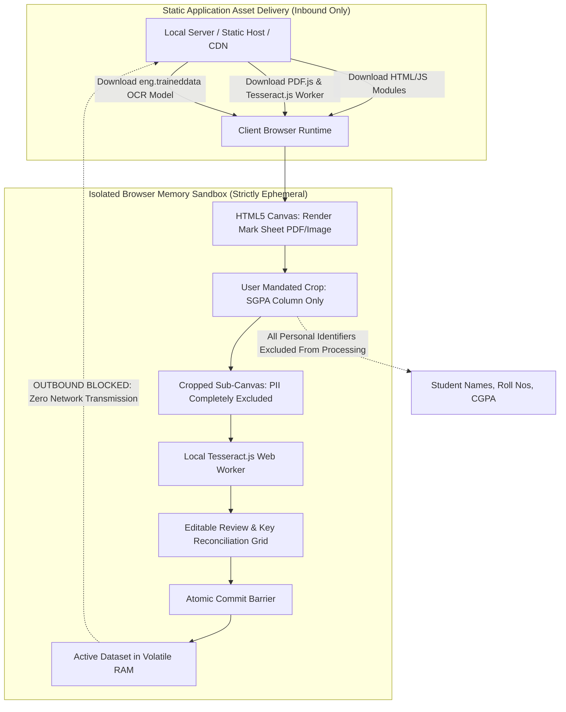

# Privacy Architecture & Security Specification — ClassPredict

> **Document ID**: DOC-SEC-001  
> **Status**: Approved & Implemented (Phase 10 Production Deployment & Hardening Verified)  
> **Lifecycle State**: Deployed & Verified (Full Privacy Architecture, Service Worker Zero-Data Guardrails, & Local Memory Verified)  
> **Last Updated**: October 2026

---

## 1. Ethical Context & Sensitive Data Principles

Undergraduate academic transcripts, course evaluations, and semester grade point averages constitute **Personally Identifiable Information (PII)** and protected student educational records under global data protection frameworks (such as GDPR, FERPA, and institutional privacy policies).

ClassPredict operates under five foundational security tenets:
1. **Zero Cloud Ingestion of Student Records**: The system does not transmit student marks, raw images, or dataset files to any remote server or cloud API. All data processing occurs locally within the user's browser memory.
2. **Strict Data Minimization & Whitelist Filtering**: Only the numerical values required for transition modeling (`student_key`, `semester_no`, `sgpa`) are accepted. Identifiers like names, registration IDs, emails, and phone numbers are rejected at the parsing boundary with an explicit security notice.
3. **Targeted Crop Boundary for OCR**: Scanned university mark sheets contain institutional headers, student names, and registration numbers. The user is required to crop strictly to the SGPA column before any OCR engine analysis occurs.
4. **Human-in-the-Loop Gatekeeping & Key Reconciliation**: Extracted data remains isolated in an ephemeral staging buffer until audited and confirmed by a human reviewer. Student keys are explicitly verified rather than inferred from row position.
5. **Session Ephemerality & Memory Purge**: Records reside exclusively in volatile browser RAM. The user can discard or purge datasets at any time, and closing or reloading the browser tab immediately purges all imported academic marks.

---

## 2. Pseudonymization vs. Anonymization

It is an essential academic and legal principle that **pseudonymization is not anonymization**:

* **Pseudonymization**: Replacing direct identifiers (e.g., "John Doe", Roll "CSE-2023-042") with an artificial pseudonymous key (e.g., `STU_042` or a SHA-256 hash). 
  - *Linkability Risk*: Pseudonymized data remains personal data. If someone possesses the original mapping key or auxiliary information (e.g., knowing only one student scored 3.98 in Semester 1), re-identification is possible via linkability.
* **Anonymization**: Irreversibly altering personal data so that the individual can no longer be identified directly or indirectly by anyone using any reasonable means.
* **ClassPredict Policy**: ClassPredict enforces **pseudonymization**. The documentation explicitly notes that pseudonymous keys remain potentially re-identifiable by department members who have access to raw university gradesheets. Therefore, generated CSV exports or screen recordings must never be shared publicly without institutional authorization.

---

## 3. Implemented Privacy Guardrails in Phase 3

### 3.1 Strict Whitelist Schema Enforcement (`data_validator.js`)
If an imported CSV includes extraneous columns (such as `name,roll_no,email,student_key,semester_no,sgpa`), the parser rejects the file immediately:
```text
Unexpected column(s) detected: name, roll_no, email.
For student privacy and data security, only 'student_key, semester_no, sgpa' are permitted.
Personal identifiers (such as names, roll numbers, or contact details) must be removed prior to upload.
```

### 3.2 Error Diagnostic Anonymity (Verified in Case 20)
* Parsing error diagnostics report line numbers and syntax issues (e.g., `"Row 8: Duplicate record detected for semester 1"` or `"Row 4: 'sgpa' is out of bounds"`).
* Error messages **never echo raw student names or PII**, preventing sensitive values from appearing in console logs or UI banners.

### 3.3 Ephemeral Staging Isolation (`state_manager.js`)
* Uploaded files reside in a temporary staging buffer (`stagedDataset`).
* If a new file is uploaded and contains validation errors, the previously accepted dataset is untouched.
* The user must click **Confirm & Accept Dataset** to commit records to session memory.
* Clicking **Discard Dataset from Memory** invokes `clearAcceptedDataset()`, setting all memory references to `null` for garbage collection.

### 3.4 Safe Client-Side CSV Export (`prediction_service.js`)
* **PII Exclusion**: Prediction export schemas strictly restrict fields to pseudonymous identifiers (`student_key`) and mathematical outputs (`latest_semester`, `latest_sgpa`, `target_semester`, `predicted_sgpa`, `baseline_prediction`, `model_name`, `prediction_status`, `out_of_range`). Names, emails, rolls, or registration numbers are never exported.
* **Missing Value Fidelity**: Unavailable predictions remain empty fields `""` in exported CSV files; they are never converted to numerical zero.
* **Zero Network Exfiltration**: All CSV file downloads are created via standard browser `Blob` creation and `URL.revokeObjectURL()` mechanisms in volatile memory. No records are ever transmitted to a backend or persisted to disk automatically. Verified in `TC-PRED-23`, `TC-PRED-24`, and `TC-PRED-25`.

---

## 4. Browser-Side OCR Privacy Architecture (Phase 7 Implemented)

### 4.1 Asset Delivery vs. Data Isolation
To evaluate privacy claims honestly, we distinguish between **static application asset downloads** (code, WASM, font, and dictionary files) and **user data transmission** (academic records):



### 4.2 Verified Privacy Boundaries (`tests/test_ocr.js`)
The Phase 7 implementation guarantees five privacy boundaries, verified by automated unit tests:

1. **Zero Source Document Exfiltration (`TC-OCR-31`)**: Uploaded PDF or image bytes are decoded strictly in memory using browser `FileReader` and HTML5 Canvas. No `fetch`, `XMLHttpRequest`, `WebSocket`, or `<form>` transmission exists anywhere in `ocr_service.js` or `ocr_engine.js`.
2. **Zero Crop or Candidate Exfiltration (`TC-OCR-32`)**: Cropped sub-canvas pixel buffers and extracted candidate strings remain within the client execution thread and local Tesseract Web Worker. No external telemetry or cloud OCR endpoints are invoked.
3. **Zero Storage Persistence (`TC-OCR-33`)**: Neither source documents, rendered canvases, nor OCR candidates are written to `localStorage`, `sessionStorage`, or `IndexedDB`. All state is held in volatile instance memory and purged when `discardTemporaryState()` is called.
4. **Strict Schema Minimization (`TC-OCR-34`)**: Extracted candidate records strictly conform to the 3-tuple schema `[student_key, semester_no, sgpa]`. Extraneous attributes (such as student names, registration numbers, or letter grades) cannot enter the accepted dataset.
5. **PII-Free Logging & Diagnostics (`TC-OCR-35`)**: Error messages, validation warnings, and status banners report numeric metrics, line numbers, and pseudonymous keys only. No personal student identifiers are emitted to system logs or UI alerts.

### 4.3 Human Confirmation Gatekeeper
* OCR candidates never enter the accepted dataset automatically.
* Every row must undergo human review, error resolution (e.g. correcting ambiguous decimals such as `376` $\to$ `3.76`), and explicit student-key reconciliation.
* Changing the crop, page selection, or rotation immediately invalidates prior reviews, preventing stale confirmation.

---

## 5. Threat Modeling (STRIDE Analysis)

| Threat Category | Potential Vector in ClassPredict | Implemented Mitigation Strategy |
| :--- | :--- | :--- |
| **Spoofing** | Attacker impersonates authorized evaluator | Client-side local application; access control is governed by the workstation's local OS login. |
| **Tampering** | Malicious CSV or altered marksheet modifying cohort history | Client-side schema validator enforces strict bounds $[0.00, 4.00]$, integer semester indices, and duplicate checks. |
| **Repudiation** | User denies performing batch prediction or OCR import | Local audit logging of operations (without printing sensitive marks) displayed in UI console. |
| **Information Disclosure** | Student names leaked via CSV headers | Whitelist schema rejection immediately halts parsing if unexpected columns like `name` or `roll_no` are detected. |
| **Information Disclosure** | Student names leaked via full-page OCR | Mandatory user-defined rectangular crop isolates strictly the SGPA column, leaving names and roll numbers unparsed. |
| **Information Disclosure** | Sensitive marks dumped to dev console | Error diagnostics cite line numbers and issue categories without printing raw records or names. |
| **Information Disclosure** | Memory residue persisted to browser storage | Zero persistence in `localStorage`/`sessionStorage`/`IndexedDB`; volatile memory references cleared on discard. |
| **Denial of Service** | Gigabyte file upload freezing browser | Ingestion parser enforces maximum file size limit (5 MB for CSV, 15 MB for OCR documents). |
| **Elevation of Privilege**| XSS injection via student key strings | Student keys are sanitized using regex `^[A-Za-z0-9_-]{1,32}$` and rendered via HTML entity escaping. |
