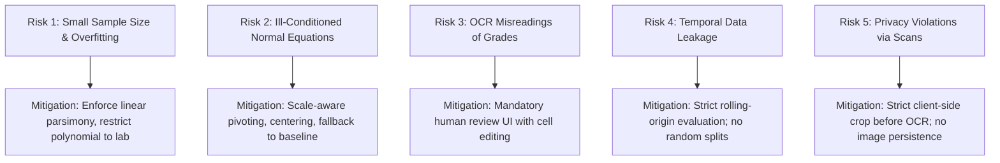

# Project Charter — Gradivue

> **Document ID**: DOC-CHARTER-001  
> **Status**: Approved (Phase 1 Baseline with Mandatory Corrections)  
> **Lifecycle State**: Designed  
> **Last Updated**: October 2026

---

## 1. Project Background & Academic Context

In university undergraduate Computer Science & Engineering (CSE) curricula, the **Numerical Methods** course establishes theoretical foundations in approximation, system solving, curve fitting, interpolation, and computational error analysis. Often, students study these algorithms in isolation (solving abstract synthetic matrices on paper or in simple CLI scripts).

**Gradivue** bridges the gap between academic numerical theory and tangible, ethical real-world software engineering. By tackling the challenge of predicting undergraduate academic performance (Semester Grade Point Average, or SGPA) based on historical records, the project grounds computational mathematics in real constraints: small sample sizes, autocorrelated transitions, noisy OCR inputs, and strict privacy boundaries.

---

## 2. Project Vision & Purpose

To engineer a transparent, maintainable, mathematically rigorous, and privacy-preserving web application that:
1. Empowers students and academic advisors to forecast next-semester SGPA trajectories with quantified uncertainty.
2. Serves as an educational laboratory for exploring numerical linear algebra and least-squares regression algorithms implemented from first principles.
3. Showcases professional-grade portfolio engineering, adhering to strict data ethics, responsive UI design, and comprehensive documentation.

---

## 3. Stakeholders & Personas

| Stakeholder Persona | Role in System | Key Needs & Expectations |
| :--- | :--- | :--- |
| **Undergraduate Student (Project Author)** | Developer, Presenter, System Maintainer | Clean, understandable codebase; deep grasp of numerical decisions for viva defense; portfolio-worthy aesthetics. |
| **Academic Course Evaluator (Professor)** | Examiner, Numerical Methods Assessor | Algorithmic transparency; implementation from first principles; honest error analysis; baseline comparisons. |
| **Department Academic Advisor** | End-User (Cohort Analytics) | Batch upload of anonymized class performance; early identification of students trending downward; zero privacy leaks. |
| **Individual Student User** | End-User (Self-Assessment) | Quick estimation of next semester's target without needing class-wide datasets; intuitive understanding of prediction uncertainty. |

---

## 4. Scope & Boundaries

### 4.1 In-Scope Capabilities
* **SGPA Prediction Only**: Estimating next-semester SGPA based solely on historical SGPA series.
* **Variable Historical Horizons**: Supporting student histories ranging from 3 to 7 completed semesters without hard-coded limits.
* **Cohort-Wide Modeling**: Ingesting anonymized long-format CSV datasets representing standard class sizes (40–80 students) to fit linear transition models.
* **Privacy-Preserving OCR Ingestion**: Allowing users to upload university mark sheets (PDF or image), crop strictly to the SGPA column, audit candidates in an editable review table with explicit key reconciliation, and manually confirm inclusion.
* **Numerical Methods Laboratory**: Interactive sandbox demonstrating linear regression with predictor centering, polynomial least-squares curve fitting with scale-aware pivoting, and Newton divided-difference interpolation.
* **Rigorous Temporal Validation**: Expanding-window backtesting comparing candidate models against a strict persistence baseline.
* **Configurable Grading Scales**: Defaulting to standard 0.00–4.00 grading scale, displaying raw mathematical predictions, and rendering explicit out-of-bounds warning badges when predictions exceed the scale.

### 4.2 Explicit Non-Goals (Out of Scope)
* **No CGPA Calculations**: Cumulative Grade Point Average involves institutional credit weighting and repeat-course replacement policies that vary across universities. CGPA is strictly excluded.
* **No Credit-Hour Dependencies**: Prediction relies strictly on semester-level performance trajectories, avoiding complex syllabus-specific credit tracking.
* **No Permanent Cloud Database**: Academic records are treated as ephemeral session state. The system will not host a persistent public database of grades.
* **No Opaque Machine Learning**: No "black-box" deep learning, neural networks, or proprietary prediction APIs. All algorithms must be numerically verifiable and defensible.
* **No Unverified OCR Ingestion**: Automated direct ingestion of OCR text into model datasets without human confirmation is strictly prohibited.

---

## 5. Constraints & Assumptions

### 5.1 Technical & Academic Constraints
* **Numerical Transparency**: All numerical linear algebra (matrix transposition, Gaussian elimination with scale-aware partial pivoting, polynomial systems, divided differences) must be implemented transparently in clean code without depending on external opaque mathematical libraries.
* **Sample Size Realities**: A class of 40–80 students with 3–7 semesters yields between 80 and 480 consecutive transitions. These sample sizes preclude high-dimensional modeling and demand high parameter parsimony.
* **Runtime & Tooling Requirements**: The application runs in modern web browsers via a local static HTTP server (e.g., Python `http.server` or Node `npx serve`) to accommodate ES6 module loading. Node.js is required only for automated test runner execution.

### 5.2 Assumptions
* Historical SGPA transitions contain a degree of positive autocorrelation (students performing well tend to continue performing well; students struggling often experience persistent friction unless intervened).
* The user possessing gradesheets has legitimate academic authorization to analyze those records.
* Users have access to clean scans or digital PDFs of university result sheets where columns are visually distinguishable.

---

## 6. Success Criteria

1. **Academic Defensibility**: The student can clearly derive and explain every mathematical formula, matrix system, condition number, and error metric during oral examination.
2. **Empirical Baseline Superiority**: The fitted linear models are benchmarked against the persistence baseline ($\hat{s}_{t+1} = s_t$). Any claim of predictive utility must be supported by empirical MAE/RMSE reductions on temporal holdouts.
3. **Privacy Integrity**: Zero instances of personally identifiable information (PII) are stored, logged, or leaked across the application lifecycle.
4. **Portfolio Excellence**: The web interface achieves a modern, responsive aesthetic (Obsidian/Crimson visual theme) with fluid interactions, zero console errors, and comprehensive test coverage.
5. **Documentation Completeness**: Every design decision is codified in Architecture Decision Records (ADRs) with an unbroken traceability matrix from requirements to tests.

---

## 7. Known Risks & Mitigation Strategies

* **Statistical Risk**: Quadratic/polynomial trends overfit drastically on short histories ($K \le 4$).  
  *Mitigation*: Restrict degree-2 models to the experimental laboratory; prohibit them as production defaults.
* **Numerical Risk**: When class SGPA variance is near zero, $(X^T X)$ becomes rank-deficient.  
  *Mitigation*: Pre-check input variance ($\text{Var}(x) < 10^{-12}$) and scale-aware pivot tolerance; gracefully fallback to baseline.
* **Data Quality Risk**: OCR engines misidentify decimals (e.g., parsing `3.05` as `305` or `3.85`).  
  *Mitigation*: Implement range checks $[0.00, 4.00]$ and provide an interactive editable review grid with key reconciliation prior to dataset insertion.
