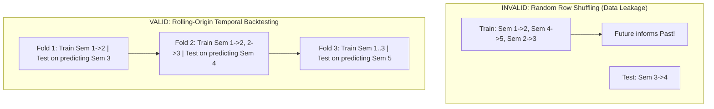

# Validation & Testing Strategy — ClassPredict

> **Document ID**: DOC-TEST-001  
> **Status**: Approved & Implemented (Phase 10 Production Deployment & Hardening Verified)  
> **Lifecycle State**: Production Release & Tested (226 Automated Tests Passing across 40 Suites)  
> **Last Updated**: October 2026

---

## 1. The Temporal Validation Philosophy

In sequential academic forecasting, **random row shuffling is mathematically invalid and constitutes temporal data leakage**.

### 1.1 Why Random Splitting Leaks Information:
* Academic progression has a chronological arrow: Semester $1 \to 2 \to 3 \to \dots \to K$.
* Training on transitions from Semester $4 \to 5$ and evaluating on Semester $2 \to 3$ allows future grading curves, student maturity, and senior curriculum standards to leak into earlier predictions.
* Furthermore, randomly splitting transitions from the same student across train and test sets creates identity leakage: the model memorizes individual student levels rather than general transition mechanics.

---

## 2. Rolling-Origin Temporal Cross-Validation

ClassPredict enforces **Expanding-Window (Rolling-Origin) Temporal Cross-Validation**:

For a dataset spanning semesters $1$ to $K$ (where $K \ge 3$):

1. **Fold 1**:
   - **Training Set**: All transitions occurring up to Semester 2 (i.e., transitions $s_1 \to s_2$).
   - **Test Set**: Transitions predicting Semester 3 (i.e., evaluate $\hat{s}_3$ given $s_2$ against actual $s_3$).
2. **Fold 2**:
   - **Training Set**: All transitions occurring up to Semester 3 (i.e., transitions $s_1 \to s_2$ and $s_2 \to s_3$).
   - **Test Set**: Transitions predicting Semester 4 (i.e., evaluate $\hat{s}_4$ given $s_3$ against actual $s_4$).
3. **Fold $T-1$**:
   - **Training Set**: All transitions occurring up to Semester $T-1$.
   - **Test Set**: Transitions predicting Semester $T$.

---

## 3. Evaluation Metrics & Baseline Benchmarking

Models are benchmarked directly against the **Persistence Baseline** ($\hat{s}_{t+1} = s_t$) evaluated over the exact same test folds.

### 3.1 Mean Absolute Error (MAE)

$$\text{MAE} = \frac{1}{M}\sum_{i=1}^M |\hat{s}_{t+1}^{(i)} - s_{t+1}^{(i)}|$$

* Linear penalty: robust to isolated outlier grades.

### 3.2 Root Mean Squared Error (RMSE)

$$\text{RMSE} = \sqrt{\frac{1}{M}\sum_{i=1}^M \left(\hat{s}_{t+1}^{(i)} - s_{t+1}^{(i)}\right)^2}$$

* Quadratic penalty: highlights large misses.

### 3.3 Relative Improvement over Baseline ($\Delta$)

$$\Delta_{\text{MAE}} = \frac{\text{MAE}_{\text{baseline}} - \text{MAE}_{\text{model}}}{\text{MAE}_{\text{baseline}}} \times 100\%$$

* If $\Delta \le 0\%$, the candidate model is empirically worse than merely predicting the student's latest grade. The UI flags this with an alert: *"Model fails to beat persistence baseline on historical holdouts."*

### 3.4 Prohibition of $R^2$ as "Accuracy"
* In non-stationary time series, high $R^2$ can arise purely from persistent student rank ordering without offering useful forecast precision. ClassPredict strictly reports MAE and RMSE in genuine SGPA units.

---

## 4. Test Suite Specification & Execution Evidence

### 4.1 Unit Test Cases: Numerical Engine & Linear Algebra (`tests/test_foundation.js` & `tests/test_linear_algebra.js`)

| Test ID | Subsystem | Test Description | Input Condition | Expected Output / Acceptance Criteria | Status |
| :--- | :--- | :--- | :--- | :--- | :--- |
| `TC-NUM-01` | `linear_algebra.js` | $2 \times 2$ Gaussian Elimination | $\begin{bmatrix} 2 & 1 \\ 1 & 3 \end{bmatrix} \mathbf{x} = \begin{bmatrix} 5 \\ 5 \end{bmatrix}$ | Solves $x_1 = 2.0, x_2 = 1.0$ within tolerance $10^{-9}$. | **`Tested` (Verified)** |
| `TC-NUM-02` | `linear_algebra.js` | Row Partial Pivoting Zero Pivot | $A = \begin{bmatrix} 0 & 2 \\ 3 & 1 \end{bmatrix}, \mathbf{b} = \begin{bmatrix} 4 \\ 7 \end{bmatrix}$ | Swaps rows 1 and 2 successfully; solves $x_1 = 1.6667, x_2 = 2.0$. | **`Tested` (Verified)** |
| `TC-NUM-03` | `linear_algebra.js` | Scale-Aware Pivot Singularity | $A = \begin{bmatrix} 2 & 4 \\ 1 & 2 \end{bmatrix}, \mathbf{b} = \begin{bmatrix} 8 \\ 4 \end{bmatrix}$ | Relative pivot $< \tau_{\text{rel}} s_{\text{scale}}$; throws `SingularMatrixError`. | **`Tested` (Verified)** |
| `TC-NUM-04` | `linear_algebra.js` | All-Zero Matrix Singularity | $A = \begin{bmatrix} 0 & 0 \\ 0 & 0 \end{bmatrix}, \mathbf{b} = \begin{bmatrix} 0 \\ 0 \end{bmatrix}$ | Matrix scale = 0; throws `SingularMatrixError`. | **`Tested` (Verified)** |
| `TC-NUM-05` | `linear_algebra.js` | Near-Singular Scale Tolerance | Row 2 differs by $10^{-15} < \tau_{\text{rel}} \|A\|_{\max}$ | Pivot falls below tolerance; throws `SingularMatrixError`. | **`Tested` (Verified)** |
| `TC-NUM-06` | `linear_algebra.js` | $3 \times 3$ System with Pivoting | $3 \times 3$ system with known solution | Solves $\mathbf{x} = [1, -2, 3]^T$ within $10^{-9}$. | **`Tested` (Verified)** |
| `TC-NUM-07` | `linear_algebra.js` | Uniform Scale Invariance | System scaled by $10^{-4}$ | Solves accurately without false singularity. | **`Tested` (Verified)** |
| `TC-NUM-08` | `linear_algebra.js` | Input Immutability | Caller's $A$ and $\mathbf{b}$ arrays | Arrays unmodified after solver execution. | **`Tested` (Verified)** |
| `TC-NUM-09` | `linear_algebra.js` | Dimension Mismatch Rejection | Non-square matrix or length mismatch | Throws `DimensionMismatchError`. | **`Tested` (Verified)** |
| `TC-NUM-10` | `linear_algebra.js` | Non-Finite Arithmetic Rejection | Inputs contain `NaN` or `Infinity` | Throws `NonFiniteValueError`. | **`Tested` (Verified)** |

### 4.2 Regression & Interpolation Test Cases (`tests/test_regression.js` & `tests/test_interpolation.js`)

| Test ID | Subsystem | Test Description | Input Condition | Expected Output / Acceptance Criteria | Status |
| :--- | :--- | :--- | :--- | :--- | :--- |
| `TC-REG-01` | `regression_engine.js` | Consecutive Transition Construction | Single student, semesters 1, 2, 3 | Produces transitions $1 \to 2$ and $2 \to 3$. | **`Tested` (Verified)** |
| `TC-REG-02` | `regression_engine.js` | Multi-Student Transition Isolation | Two distinct students' records | Transitions never mix records across students. | **`Tested` (Verified)** |
| `TC-REG-03` | `regression_engine.js` | Missing Semester Gap Handling | Semesters 1, 2, 4 (sem 3 missing) | Produces $1 \to 2$; strictly skips $2 \to 4$; no bridging. | **`Tested` (Verified)** |
| `TC-REG-04` | `regression_engine.js` | Duplicate Record Rejection | Duplicate `(student_key, sem)` | Throws error rejecting duplicate pair. | **`Tested` (Verified)** |
| `TC-REG-05` | `regression_engine.js` | Deterministic Transition Ordering | Unsorted input records | Sorted by `student_key` ASC, `from_semester` ASC. | **`Tested` (Verified)** |
| `TC-REG-06` | `regression_engine.js` | Persistence Baseline Output | Valid SGPA input 3.45 | Predicts $\hat{s}_{t+1} = 3.45$; input unmutated. | **`Tested` (Verified)** |
| `TC-REG-07` | `regression_engine.js` | Persistence Scale Validation | Out-of-scale SGPA 4.50 | Raw output 4.50 preserved without clipping; flagged. | **`Tested` (Verified)** |
| `TC-REG-08` | `regression_engine.js` | Exact Linear Regression | Points on $y = 0.5x + 1.8$ | Intercept $a = 1.80$, Slope $b = 0.50$, $R^2 = 1.0$. | **`Tested` (Verified)** |
| `TC-REG-09` | `regression_engine.js` | Predictor Centering & Recovery | Non-zero mean predictor data | Converts centered parameters back to original domain. | **`Tested` (Verified)** |
| `TC-REG-10` | `regression_engine.js` | Noisy Transition Regression | Empirical academic transition data | Fits stable slope and intercept; $R^2$ computed. | **`Tested` (Verified)** |
| `TC-REG-11` | `regression_engine.js` | Near-Zero Variance Rejection | Constant predictor $x_i = 3.20$ | Rejects fit; $\text{Var}(x) < 10^{-12}$; actionable error. | **`Tested` (Verified)** |
| `TC-REG-12` | `regression_engine.js` | Insufficient Sample Rejection | $n = 1$ observation | Rejects fit; $n < 2$ requires at least 2 points. | **`Tested` (Verified)** |
| `TC-REG-13` | `regression_engine.js` | Raw Prediction Preservation | Predictor extrapolating to 4.20 | Raw 4.20 returned; flagged out-of-range; not clipped. | **`Tested` (Verified)** |
| `TC-INT-01` | `interpolation_engine.js`| Divided-Difference Computation | Known points $(1, 3.0), (2, 3.2), (3, 3.6)$ | Computes coefficients $c = [3.0, 0.2, 0.1]$. | **`Tested` (Verified)** |
| `TC-INT-02` | `interpolation_engine.js`| Node Reproduction Guarantee | Interpolation nodes $(x_i, y_i)$ | $P_n(x_i) = y_i$ within $10^{-12}$ for all nodes. | **`Tested` (Verified)** |
| `TC-INT-03` | `interpolation_engine.js`| Interior Smooth Evaluation | Interior evaluation point $x = 1.5$ | Evaluates smoothly without singularities. | **`Tested` (Verified)** |
| `TC-INT-04` | `interpolation_engine.js`| Extrapolation Domain Tagging | Point $x = 4.0$ outside $[1.0, 3.0]$ | Flags `isExtrapolation: true`. | **`Tested` (Verified)** |
| `TC-INT-05` | `interpolation_engine.js`| Duplicate Node Rejection | Nodes with identical $x$ coordinate | Throws error rejecting duplicate interpolation nodes. | **`Tested` (Verified)** |

### 4.3 Data Validation & Parsing Test Cases (`tests/test_csv_parser.js`)

All 20 required verification cases executed and passing:

| Test Case | Subsystem | Description & Input Condition | Expected Output / Acceptance Criteria | Status |
| :--- | :--- | :--- | :--- | :--- |
| **Case 1** | `data_validator.js` | Standard valid CSV parsing | Parses 1 header and 2 data rows accurately. | **`Tested` (Verified)** |
| **Case 2** | `data_validator.js` | Quoted fields and escaped quotes (`""`) | Unescapes `""` to `"`, preserves commas inside quotes. | **`Tested` (Verified)** |
| **Case 3** | `data_validator.js` | Empty file and whitespace | Returns empty array and flags invalid file with clear message. | **`Tested` (Verified)** |
| **Case 4** | `data_validator.js` | Header-only CSV | Flags error citing lack of data rows. | **`Tested` (Verified)** |
| **Case 5** | `data_validator.js` | Missing required column (`sgpa`) | Rejects file, naming missing required header. | **`Tested` (Verified)** |
| **Case 6** | `data_validator.js` | Unexpected personal information columns | Rejects `name` and `roll_no`; cites privacy policy. | **`Tested` (Verified)** |
| **Case 7** | `data_validator.js` | Empty or malformed student key | Rejects row with missing key. | **`Tested` (Verified)** |
| **Case 8** | `data_validator.js` | Invalid semester numbers (0, -1, 2.5, abc) | Flags all non-positive-integer semester values. | **`Tested` (Verified)** |
| **Case 9** | `data_validator.js` | Malformed SGPA and decimal commas | Rejects decimal commas (`3,45`) and text tokens. | **`Tested` (Verified)** |
| **Case 10** | `data_validator.js` | SGPA out of scale ($< 0.00$ or $> 4.00$) | Flags out-of-scale values with exact row numbers. | **`Tested` (Verified)** |
| **Case 11** | `data_validator.js` | `NaN` and `Infinity` tokens | Rejects non-finite values. | **`Tested` (Verified)** |
| **Case 12** | `data_validator.js` | Duplicate `(student_key, semester_no)` | Detects duplicates without leaking raw marks. | **`Tested` (Verified)** |
| **Case 13** | `data_validator.js` | Variable histories (3 to 7 semesters) | Accurately computes horizon distribution. | **`Tested` (Verified)** |
| **Case 14** | `data_validator.js` | Missing semester gaps ($s_1, s_2, s_4$) | Flags missing gaps and preserves actual semester indices. | **`Tested` (Verified)** |
| **Case 15** | `data_validator.js` | Multiple students cohort | Accurately aggregates unique students and records. | **`Tested` (Verified)** |
| **Case 16** | `data_validator.js` | Deterministic normalization sort | Records sorted primarily by key ASC, semester ASC. | **`Tested` (Verified)** |
| **Case 17** | `data_validator.js` | Stable pseudonymous key persistence | Preserves key identically across all semester rows. | **`Tested` (Verified)** |
| **Case 18** | `state_manager.js` | Staging protection on invalid import | Invalid upload does NOT overwrite accepted dataset. | **`Tested` (Verified)** |
| **Case 19** | `state_manager.js` | In-memory purge on discard/clear | `clearAcceptedDataset()` completely wipes memory heap. | **`Tested` (Verified)** |
| **Case 20** | `data_validator.js` | Privacy guard in diagnostics | Errors cite line numbers without printing raw student names. | **`Tested` (Verified)** |

### 4.4 Temporal Validation & Model Evaluation Test Cases (`tests/test_validation.js`)

All 24 required Phase 5 verification test scenarios executed and passing:

| Test ID | Subsystem | Description & Input Condition | Expected Output / Acceptance Criteria | Status |
| :--- | :--- | :--- | :--- | :--- |
| `TC-VAL-01` | `temporal_validator.js` | Known-sample MAE computation | Actual `[3.0, 3.5, 4.0]`, Predicted `[3.2, 3.4, 3.7]` | Evaluates $\text{MAE} = 0.20$ exactly. | **`Tested` (Verified)** |
| `TC-VAL-02` | `temporal_validator.js` | Known-sample RMSE computation | Actual `[3.0, 3.5, 4.0]`, Predicted `[3.2, 3.4, 3.7]` | Evaluates $\text{RMSE} = \sqrt{0.14 / 3} \approx 0.2160$. | **`Tested` (Verified)** |
| `TC-VAL-03` | `temporal_validator.js` | Zero error on perfect predictions | Actual identical to predicted | $\text{MAE} = 0.0, \text{RMSE} = 0.0$ within machine precision. | **`Tested` (Verified)** |
| `TC-VAL-04` | `temporal_validator.js` | Empty evaluation arrays rejection | `computeMae([], [])`, `computeRmse([], [])` | Throws actionable Error rejecting empty inputs. | **`Tested` (Verified)** |
| `TC-VAL-05` | `temporal_validator.js` | Length mismatch rejection | `actual.length !== predicted.length` | Throws Error citing array length disparity. | **`Tested` (Verified)** |
| `TC-VAL-06` | `temporal_validator.js` | Non-finite values rejection | Arrays containing `NaN`, `Infinity`, `-Infinity` | Throws Error preventing numerical poisoning. | **`Tested` (Verified)** |
| `TC-VAL-07` | `temporal_validator.js` | Strict chronological training split | 3-student cohort across 5 semesters | For fold $t$, training strictly targets $< t$. | **`Tested` (Verified)** |
| `TC-VAL-08` | `temporal_validator.js` | Zero test-in-train overlap | Disjoint test and training partitions | Intersection of training and test sets is empty. | **`Tested` (Verified)** |
| `TC-VAL-09` | `temporal_validator.js` | Monotonically expanding training window | Multi-semester cohort ($K=6$) | $M_{\text{train}}(t+1) \ge M_{\text{train}}(t)$ strictly holds. | **`Tested` (Verified)** |
| `TC-VAL-10` | `temporal_validator.js` | Missing gap preservation | Student with semesters 1, 2, 4 (3 missing) | Preserves gap; skips $2 \to 4$; no artificial transitions. | **`Tested` (Verified)** |
| `TC-VAL-11` | `temporal_validator.js` | Multi-student transition isolation | Cohort with 4 students across 3 semesters | 8 transitions correctly mapped; zero identity leaks. | **`Tested` (Verified)** |
| `TC-VAL-12` | `temporal_validator.js` | Explicit status on insufficient data | Empty dataset, 1-semester data, 2-semester data | Returns explicit statuses; zero fabricated metrics. | **`Tested` (Verified)** |
| `TC-VAL-13` | `temporal_validator.js` | Identical targets for paired models | Paired regression vs baseline comparisons | Both models evaluated on identical $s_t$ values. | **`Tested` (Verified)** |
| `TC-VAL-14` | `temporal_validator.js` | Persistence baseline forecast | Observed $s_{t-1} = 3.15$ | Forecasts $\hat{s}_t = 3.15$ exactly. | **`Tested` (Verified)** |
| `TC-VAL-15` | `temporal_validator.js` | Prior-window model fitting | Fold targeting semester 3 | Coefficients match independent fit on $1 \to 2$ data. | **`Tested` (Verified)** |
| `TC-VAL-16` | `temporal_validator.js` | Explicit regression fitting failure | Zero variance in training predictor | Sets status `FIT_FAILED`; records failure message. | **`Tested` (Verified)** |
| `TC-VAL-17` | `temporal_validator.js` | Baseline survival during fit failure | Fold where regression fitting failed | Baseline MAE and RMSE remain fully computed. | **`Tested` (Verified)** |
| `TC-VAL-18` | `temporal_validator.js` | Raw out-of-range preservation | Steep slope extrapolating to $> 4.00$ | Raw prediction preserved; `is_out_of_range: true`. | **`Tested` (Verified)** |
| `TC-VAL-19` | `temporal_validator.js` | Non-finite prediction protection | Validates finite numbers across predictions | Prevents NaN propagation into summary metrics. | **`Tested` (Verified)** |
| `TC-VAL-20` | `temporal_validator.js` | Future-alteration invariance (Anti-Leak) | Modifying future Sem 3/4 SGPAs | Earlier fold coefficients ($a, b$) identical to $10^{-14}$. | **`Tested` (Verified)** |
| `TC-VAL-21` | `temporal_validator.js` | Strict future transition exclusion | All temporal folds | $\max(\text{to\_semester}_{\text{train}}) < t$ verified. | **`Tested` (Verified)** |
| `TC-VAL-22` | `temporal_validator.js` | Pooled metrics vs unweighted average | Folds of size 2 (err 0.1) and 10 (err 0.9) | Pooled MAE is $0.7667$, NOT unweighted $0.50$. | **`Tested` (Verified)** |
| `TC-VAL-23` | `temporal_validator.js` | Failed fold status integrity | Insufficient training fold ($M=1 < 2$) | Status is `INSUFFICIENT_TRAINING_DATA`; zero fake MAE. | **`Tested` (Verified)** |
| `TC-VAL-24` | `temporal_validator.js` | Caller input immutability | Input records array | Deep copy guarantees original array is unmodified. | **`Tested` (Verified)** |

---

## 4.5 Phase 6 Verification Test Suite: Prediction Workflows & Safe Export

All 26 required Phase 6 verification test scenarios executed and passing in `tests/test_prediction.js`:

| Test ID | Subsystem | Description & Input Condition | Expected Output / Acceptance Criteria | Status |
| :--- | :--- | :--- | :--- | :--- |
| `TC-PRED-01` | `prediction_service.js` | Valid 3-semester history | History: Sem 1 (3.20), Sem 2 (3.40), Sem 3 (3.60) | Target Sem 4, $\hat{s} = 3.80$, $\nu = 1, t_{\text{crit}} = 12.71$. | **`Tested` (Verified)** |
| `TC-PRED-02` | `prediction_service.js` | Valid 7-semester history | History: Sem 1 to 7 | Target Sem 8, $\hat{s}$ computed, $\nu = 5, t_{\text{crit}} = 2.571$. | **`Tested` (Verified)** |
| `TC-PRED-03` | `prediction_service.js` | Unordered semester sorting | Semesters entered as `[3, 1, 2]` | Chronologically sorted before fitting; target semester 4. | **`Tested` (Verified)** |
| `TC-PRED-04` | `prediction_service.js` | Duplicate semester rejection | Duplicate semester 2 in history | Throws actionable Error citing duplicate semester number. | **`Tested` (Verified)** |
| `TC-PRED-05` | `prediction_service.js` | Out-of-scale / invalid SGPA | SGPA $4.50 > 4.00$ or negative | Throws Error identifying out-of-scale observation. | **`Tested` (Verified)** |
| `TC-PRED-06` | `regression_engine.js` | Known linear dataset trend | $s_k = 2.00 + 0.30\,k$ for $k=1, 2, 3, 4$ | Evaluates $a = 2.00, b = 0.30$, Sem 5 forecast $= 3.5000$. | **`Tested` (Verified)** |
| `TC-PRED-07` | `prediction_service.js` | Next actual semester targeting | Gapped history: Sem 1, 2, 4 | Target semester is $\max(k) + 1 = 5$ (not 3 or 4). | **`Tested` (Verified)** |
| `TC-PRED-08` | `prediction_service.js` | Insufficient history handling | History length $K < 3$ or $K > 7$ | Throws descriptive Error specifying 3–7 observation rule. | **`Tested` (Verified)** |
| `TC-PRED-09` | `prediction_service.js` | Shared model unavailability | No cohort model loaded in session | Returns status `MODEL_UNAVAILABLE` with guidance. | **`Tested` (Verified)** |
| `TC-PRED-10` | `prediction_service.js` | Persistence baseline forecast | Latest observed SGPA $= 3.50$ | Forecast is $3.5000$ exactly; labeled as Baseline. | **`Tested` (Verified)** |
| `TC-PRED-11` | `prediction_service.js` | Unclipped out-of-range preservation | Steep slope extrapolating to $4.30$ | Preserves raw $4.30$; flags `isOutOfRange: true`. | **`Tested` (Verified)** |
| `TC-PRED-12` | `prediction_service.js` | Caller input immutability | Input observations array | Caller array order and objects remain strictly untouched. | **`Tested` (Verified)** |
| `TC-PRED-13` | `prediction_service.js` | Multi-student independence | Multi-student synthetic dataset | Computes distinct targets and latest SGPAs per student. | **`Tested` (Verified)** |
| `TC-PRED-14` | `prediction_service.js` | Valid consecutive transitions only | Cohort transitions | Shared model fitted strictly on valid 1-step transitions. | **`Tested` (Verified)** |
| `TC-PRED-15` | `prediction_service.js` | Non-bridging of semester gaps | Student with Sem 1 and 3 | Gap $1 \to 3$ produces 0 transitions; no bridging. | **`Tested` (Verified)** |
| `TC-PRED-16` | `prediction_service.js` | Explicit shared model fit failure | Cohort with zero variance transitions | Status `MODEL_UNAVAILABLE`; records exact reason. | **`Tested` (Verified)** |
| `TC-PRED-17` | `prediction_service.js` | Regression vs baseline distinction | Valid cohort predictions | Regression and persistence estimates stored independently. | **`Tested` (Verified)** |
| `TC-PRED-18` | `prediction_service.js` | No silent fallback mislabeling | Failed regression fit | Baseline predictions preserved; regression NOT mislabeled. | **`Tested` (Verified)** |
| `TC-PRED-19` | `prediction_service.js` | Cohort representation in export | All students in cohort | Every student key represented in whole-class CSV. | **`Tested` (Verified)** |
| `TC-PRED-20` | `prediction_service.js` | Export fidelity to in-memory | In-memory predictions | CSV rows match in-memory numeric values exactly. | **`Tested` (Verified)** |
| `TC-PRED-21` | `prediction_service.js` | Phase 5 evaluation evidence attachment | Cohort with holdout folds | Attaches paired MAE/RMSE and holdout comparison flags. | **`Tested` (Verified)** |
| `TC-PRED-22` | `prediction_service.js` | Zero metric fabrication | Dataset with no holdouts | `temporalSummary` is `null`; zero fabricated numbers. | **`Tested` (Verified)** |
| `TC-PRED-23` | `prediction_service.js` | RFC-4180 CSV compliance | Whole-class CSV export | Uses `\r\n`, escaped strings, and standard header. | **`Tested` (Verified)** |
| `TC-PRED-24` | `prediction_service.js` | PII exclusion from CSV export | Exported CSV text | Omits names, emails, rolls, registration numbers. | **`Tested` (Verified)** |
| `TC-PRED-25` | `prediction_service.js` | Unavailable prediction export | Unavailable forecast | Exported as empty string `""`, never converted to zero. | **`Tested` (Verified)** |
| `TC-PRED-26` | `prediction_service.js` | Individual export formatting | Single student forecast result | Includes header metadata, model info, and observations. | **`Tested` (Verified)** |

---

## 4.6 Phase 7 Verification Test Suite: Privacy-Preserving OCR & Key Reconciliation

All 36 required Phase 7 verification test scenarios executed and passing in `tests/test_ocr.js`:

| Test ID | Subsystem | Description & Input Condition | Expected Output / Acceptance Criteria | Status |
| :--- | :--- | :--- | :--- | :--- |
| `TC-OCR-01` | `ocr_engine.js` | File extension & MIME validation | `.pdf, .png, .jpg, .webp` accepted; `.exe, .docx` rejected | Rejects unsupported extensions and MIME types with actionable error. | **`Tested` (Verified)** |
| `TC-OCR-02` | `ocr_engine.js` | Corrupted / empty file rejection | Zero-byte buffer or null file | Throws descriptive error rejecting empty or unreadable payloads. | **`Tested` (Verified)** |
| `TC-OCR-03` | `ocr_service.js` | Invalid page selection | Requesting page 0 or page $> \text{totalPages}$ | Rejects invalid page number; enforces $1 \le \text{page} \le \text{total}$. | **`Tested` (Verified)** |
| `TC-OCR-04` | `ocr_engine.js` | File-size & dimension constraints | File $> 15\text{MB}$ or dimensions $> 8000\text{px}$ | Rejects excessively large documents to guard against memory exhaustion. | **`Tested` (Verified)** |
| `TC-OCR-05` | `ocr_engine.js` | Display to natural crop transform | Scaled display canvas (e.g. $400 \times 500$ vs $800 \times 1000$) | Accurately maps display bounding box to natural image coordinates. | **`Tested` (Verified)** |
| `TC-OCR-06` | `ocr_engine.js` | Rotation angle coordinate mapping | Crops applied at 0°, 90°, 180°, and 270° | Accurately transforms crop rectangle relative to natural document orientation. | **`Tested` (Verified)** |
| `TC-OCR-07` | `ocr_engine.js` | Synthetic SGPA extraction | Vertical column of valid numbers (`3.45`, `3.80`, `2.95`) | Extracts candidates with correct parsed floats, confidences, and line indices. | **`Tested` (Verified)** |
| `TC-OCR-08` | `ocr_engine.js` | Invalid numeric token detection | Non-numeric tokens (`"AB"`, `"FAILED"`, `"--"`) | Sets status to `INVALID`; flags extraction warning. | **`Tested` (Verified)** |
| `TC-OCR-09` | `ocr_engine.js` | Ambiguous candidate detection | Multiple numbers on a single line (`"3.25 3.70"`) | Flags row as `AMBIGUOUS`; requires human clarification. | **`Tested` (Verified)** |
| `TC-OCR-10` | `ocr_engine.js` | Decimal ambiguity handling | Missing decimal integer (e.g. `376`) | Proposes `3.76`, flags `AMBIGUOUS`, and requires human review. | **`Tested` (Verified)** |
| `TC-OCR-11` | `ocr_engine.js` | Out-of-scale SGPA detection | Values $< 0.00$ or $> 4.00$ (e.g. `4.50`) | Flags out-of-scale candidate; requires human correction. | **`Tested` (Verified)** |
| `TC-OCR-12` | `ocr_engine.js` | Missing / unreadable row handling | OCR noise or blank marksheet row | Flags `UNREADABLE`; never silently converts unreadable rows to zero. | **`Tested` (Verified)** |
| `TC-OCR-13` | `ocr_engine.js` | Low confidence review trigger | Line confidence below threshold ($< 60\%$) | Flags candidate for mandatory human audit even if numeric value parses. | **`Tested` (Verified)** |
| `TC-OCR-14` | `ocr_service.js` | OCR worker error isolation | Worker failure or canvas rendering fault | Propagates error to UI; leaves previously accepted dataset untouched. | **`Tested` (Verified)** |
| `TC-OCR-15` | `ocr_engine.js` | Explicit existing key mapping | Existing keys `SYN_001`, `SYN_002` selected | Correctly reconciles candidate rows to specified existing keys. | **`Tested` (Verified)** |
| `TC-OCR-16` | `ocr_engine.js` | New unique key generation | User requests new student creation | Generates non-colliding pseudonymous key (`SYN_003`). | **`Tested` (Verified)** |
| `TC-OCR-17` | `ocr_engine.js` | Duplicate key/semester rejection | Assigning existing `(SYN_001, Sem 1)` twice | Flags collision error; prevents duplicate records. | **`Tested` (Verified)** |
| `TC-OCR-18` | `ocr_engine.js` | Multi-semester key stability | Import Semester 2 after Semester 1 | Maintains identical pseudonymous keys across semester sheets. | **`Tested` (Verified)** |
| `TC-OCR-19` | `ocr_engine.js` | No row-position identity inference | Reordered students across semester sheets | Enforces explicit key mapping; never matches students by row position. | **`Tested` (Verified)** |
| `TC-OCR-20` | `ocr_engine.js` | Identical SGPA record separation | Two distinct students scoring $3.75$ | Keeps records separate; does not merge identical values. | **`Tested` (Verified)** |
| `TC-OCR-21` | `ocr_engine.js` | Missing key mapping barrier | Unassigned key in review grid | Flags missing key error; blocks dataset confirmation. | **`Tested` (Verified)** |
| `TC-OCR-22` | `state_manager.js` | Staging isolation barrier | Extracted candidates prior to confirmation | Unconfirmed OCR candidates cannot enter `stateManager.acceptedDataset`. | **`Tested` (Verified)** |
| `TC-OCR-23` | `ocr_service.js` | Review version validation | Confirming stale review token | Rejects confirmation if review version is stale or out of sync. | **`Tested` (Verified)** |
| `TC-OCR-24` | `ocr_service.js` | Review invalidation on crop change | Modifying crop box or rotating image | Automatically invalidates previous OCR results and review state. | **`Tested` (Verified)** |
| `TC-OCR-25` | `state_manager.js` | Rollback on invalid import | Import with corrupted value (e.g. `NaN`) | Preserves previously accepted dataset completely unchanged. | **`Tested` (Verified)** |
| `TC-OCR-26` | `state_manager.js` | Atomic dataset commitment | Valid reviewed rows committed | Merges atomically into `acceptedDataset` and updates metadata. | **`Tested` (Verified)** |
| `TC-OCR-27` | `state_manager.js` | Conflict rejection on commitment | Proposed row conflicts with accepted row | Commitment fails atomically; accepted dataset preserved. | **`Tested` (Verified)** |
| `TC-OCR-28` | `ocr_service.js` | Import cancellation safety | User discards or cancels OCR import | Discards temporary buffers; leaves accepted dataset untouched. | **`Tested` (Verified)** |
| `TC-OCR-29` | `prediction_service.js` | Prediction pipeline availability | Committed OCR records | Successfully utilized by individual and class prediction engines. | **`Tested` (Verified)** |
| `TC-OCR-30` | `ocr_service.js` | Ephemeral memory cleanup | Calling `discardTemporaryState()` | Purges all document bytes, canvas buffers, and candidate arrays. | **`Tested` (Verified)** |
| `TC-OCR-31` | `ocr_service.js` | Zero document exfiltration | PDF/image loading pipeline | Verifies zero outbound network calls (`fetch`, `XHR`, `WebSocket`). | **`Tested` (Verified)** |
| `TC-OCR-32` | `ocr_service.js` | Zero crop/text exfiltration | Sub-canvas cropping & OCR pipeline | Verifies zero outbound transmission of pixel data or text candidates. | **`Tested` (Verified)** |
| `TC-OCR-33` | `ocr_service.js` | Zero storage persistence | Ingestion, crop, and review stages | Verifies zero writes to `localStorage`, `sessionStorage`, or `IndexedDB`. | **`Tested` (Verified)** |
| `TC-OCR-34` | `ocr_engine.js` | Strict schema minimization | Generated candidate records | Strictly enforces schema `[student_key, semester_no, sgpa]`; zero PII columns. | **`Tested` (Verified)** |
| `TC-OCR-35` | `ocr_engine.js` | Diagnostic PII exclusion | Error and warning messages | Diagnostics cite line numbers and keys without printing sensitive names. | **`Tested` (Verified)** |
| `TC-OCR-36` | `test_runner.js` | Full regression integrity | Regression suite across Phases 2–6 | All 115 previous tests continue to pass identically. | **`Tested` (Verified)** |

---

## 4.7 Phase 8 Verification Test Suite: Analytical Dashboard & Data Visualization

All 33 required Phase 8 verification test scenarios executed and passing in `tests/test_dashboard.js`:

| Test ID | Subsystem | Description & Input Condition | Expected Output / Acceptance Criteria | Status |
| :--- | :--- | :--- | :--- | :--- |
| `TC-DASH-01` | `dashboard_analytics.js` | Unique student count | Multi-student synthetic cohort | Accurately counts distinct student keys. | **`Tested` (Verified)** |
| `TC-DASH-02` | `dashboard_analytics.js` | Accepted record count | Multi-student dataset | Computes total accepted records count. | **`Tested` (Verified)** |
| `TC-DASH-03` | `dashboard_analytics.js` | Observed semester span | Dataset with Sem 1, 2, 3 | Evaluates minSemester = 1, maxSemester = 3. | **`Tested` (Verified)** |
| `TC-DASH-04` | `dashboard_analytics.js` | Valid consecutive transition count | Cohort with gaps and consecutive pairs | Accurately tallies strictly one-step transitions. | **`Tested` (Verified)** |
| `TC-DASH-05` | `dashboard_analytics.js` | Missing gap and horizon detection | Student with Sem 1 and 3 (missing 2) | Identifies incomplete histories and students with gaps. | **`Tested` (Verified)** |
| `TC-DASH-06` | `dashboard_analytics.js` | Empty dataset overview handling | Empty `[]` and `null` dataset | Returns explicit empty state; zero fabricated metrics. | **`Tested` (Verified)** |
| `TC-DASH-07` | `dashboard_analytics.js` | Histogram uniform bin allocation | 10 observations across $[0.00, 4.00]$ | Allocates observations into 8 uniform bins of width 0.50. | **`Tested` (Verified)** |
| `TC-DASH-08` | `dashboard_analytics.js` | Bin boundary condition handling | Values on boundaries ($0.00, 0.50, 3.50, 4.00$) | Enforces lower inclusive, upper exclusive (except ceiling). | **`Tested` (Verified)** |
| `TC-DASH-09` | `dashboard_analytics.js` | Quartiles & Tukey whiskers | Continuous linear quantile interpolation | Accurately evaluates $Q_1$, Median, $Q_3$, IQR, and whiskers. | **`Tested` (Verified)** |
| `TC-DASH-10` | `dashboard_analytics.js` | Missing semester distribution handling | Requesting unobserved semester | Returns `insufficientData: true` without errors. | **`Tested` (Verified)** |
| `TC-DASH-11` | `dashboard_analytics.js` | Small sample distribution notice | Small sample $n = 2 < 4$ | Flags sampling variability notice; avoids crashing. | **`Tested` (Verified)** |
| `TC-DASH-12` | `dashboard_analytics.js` | Transition scatter plot data mapping | Consecutive transitions | Pairs $(s_t, s_{t+1})$ accurately for all valid transitions. | **`Tested` (Verified)** |
| `TC-DASH-13` | `dashboard_analytics.js` | Regression line coefficient fidelity | Known linear transition trend | Uses exact fitted slope and intercept from numerical engine. | **`Tested` (Verified)** |
| `TC-DASH-14` | `dashboard_analytics.js` | Unfittable regression line safety | $n = 1$ transition | Omits regression line; does not fabricate artificial slope. | **`Tested` (Verified)** |
| `TC-DASH-15` | `dashboard_analytics.js` | In-sample residual calculation | $e_i = y_i - \hat{y}_i$ | Correct residual signs; verifies mean residual $\approx 0$. | **`Tested` (Verified)** |
| `TC-DASH-16` | `dashboard_analytics.js` | In-sample residual distinction | Residuals metadata | Explicitly labels in-sample fit vs out-of-sample prediction. | **`Tested` (Verified)** |
| `TC-DASH-17` | `dashboard_analytics.js` | Gap exclusion from scatter & residuals | Student with non-consecutive Sem 1 & 3 | Strictly excludes gap transition from plotted data. | **`Tested` (Verified)** |
| `TC-DASH-18` | `dashboard_analytics.js` | Phase 5 evaluation metric fidelity | Multi-semester expanding window folds | Matches Phase 5 MAE and RMSE metrics exactly. | **`Tested` (Verified)** |
| `TC-DASH-19` | `dashboard_analytics.js` | Paired comparison count fidelity | Expanding-window holdout folds | Counts paired comparison records where both models forecasted. | **`Tested` (Verified)** |
| `TC-DASH-20` | `dashboard_analytics.js` | Pooled RMSE aggregation integrity | Multi-fold evaluations | Uses pooled RMSE directly from pooled prediction records. | **`Tested` (Verified)** |
| `TC-DASH-21` | `dashboard_analytics.js` | Fold status taxonomy distinction | Successful, skipped, and failed folds | Preserves exact fold statuses (`EVALUATED`, `INSUFFICIENT_TRAINING_DATA`). | **`Tested` (Verified)** |
| `TC-DASH-22` | `dashboard_analytics.js` | Insufficient evaluation data handling | Cohort with $K < 3$ semesters | Returns explicit unavailable state with clear rationale. | **`Tested` (Verified)** |
| `TC-DASH-23` | `dashboard_analytics.js` | Transition matrix consecutive counts | Multi-semester cohort | Correctly tallies transitions where $c = r + 1$. | **`Tested` (Verified)** |
| `TC-DASH-24` | `dashboard_analytics.js` | Non-consecutive gap matrix marking | Gaps where $c - r > 1$ | Cells strictly marked `Gap (0)` and `GAP_SKIPPED`. | **`Tested` (Verified)** |
| `TC-DASH-25` | `dashboard_analytics.js` | Deterministic 1.5x IQR outlier detection | Outlier SGPA value ($1.20$) | Identifies review candidate; reports deviation and bounds. | **`Tested` (Verified)** |
| `TC-DASH-26` | `dashboard_analytics.js` | Non-mutation of dataset on outlier check | Outlier detection execution | Preserves input dataset 100% unaltered; no auto-deletion. | **`Tested` (Verified)** |
| `TC-DASH-27` | `dashboard_analytics.js` | Small sample outlier notice | Sample size $n < 4$ | Evaluates zero candidates on undersized samples safely. | **`Tested` (Verified)** |
| `TC-DASH-28` | `dashboard_view.js` | Reactive update on CSV accept | Load and accept CSV in `stateManager` | Dashboard overview and transitions update immediately. | **`Tested` (Verified)** |
| `TC-DASH-29` | `dashboard_view.js` | Reactive update on OCR confirm | Reconcile and commit OCR rows | Dashboard refreshes and incorporates new cohort rows. | **`Tested` (Verified)** |
| `TC-DASH-30` | `dashboard_view.js` | In-memory clear on dataset discard | `stateManager.clearAcceptedDataset()` | Dashboard purges metrics and displays educational empty state. | **`Tested` (Verified)** |
| `TC-DASH-31` | `dashboard_view.js` | Stale data prevention on replacement | Ingesting replacement dataset | All summaries reflect new dataset; zero stale caching. | **`Tested` (Verified)** |
| `TC-DASH-32` | `dashboard_analytics.js` | PII exclusion from analytics | JSON serialization of chart outputs | Strictly omits `name, roll_no, email, phone`. | **`Tested` (Verified)** |
| `TC-DASH-33` | `test_runner.js` | Full regression integrity | Regression suite across Phases 2–7 | All 151 previous tests continue to pass identically. | **`Tested` (Verified)** |

---

## 4.8 Phase 9 Verification Test Suite: Interactive Numerical Methods Educational Laboratory

All 32 required Phase 9 verification test scenarios executed and passing in `tests/test_numerical_lab.js`:

| Test ID | Subsystem | Description & Input Condition | Expected Output / Acceptance Criteria | Status |
| :--- | :--- | :--- | :--- | :--- |
| `TC-LAB-01` | `numerical_lab.js` | Known well-conditioned 3x3 system | Standard $3 \times 3$ system $A\mathbf{x} = \mathbf{b}$ | Solution is exactly $[1, 2, 3]$; residual norm $\|\mathbf{r}\|_2 < 10^{-12}$. | **`Tested` (Verified)** |
| `TC-LAB-02` | `numerical_lab.js` | Zero pivot row swap requirement | $A_{0,0} = 0$ in $2 \times 2$ system | Row swap recorded ($R_1 \leftrightarrow R_2$); solution is accurate. | **`Tested` (Verified)** |
| `TC-LAB-03` | `numerical_lab.js` | Row elimination multiplier accuracy | $A = [[4, 1], [2, 3]]$ | Multiplier $m_{21} = 2/4 = 0.5000$ recorded in elimination step. | **`Tested` (Verified)** |
| `TC-LAB-04` | `numerical_lab.js` | Elimination trace sequence fidelity | Step sequence logging | Steps follow initial $\to$ pivot $\to$ swap $\to$ elim $\to$ backsub $\to$ done. | **`Tested` (Verified)** |
| `TC-LAB-05` | `numerical_lab.js` | Back substitution order | Reverse variable solving | Back-substitution solves $x_n$ down to $x_1$ in reverse order. | **`Tested` (Verified)** |
| `TC-LAB-06` | `numerical_lab.js` | Singular system rejection | Linearly dependent rows | Halts with `SingularMatrixError`; zero fabricated numbers. | **`Tested` (Verified)** |
| `TC-LAB-07` | `numerical_lab.js` | Matrix dimension boundary validation | Matrix $< 2 \times 2$ or $> 5 \times 5$ | Rejects invalid dimensions with `DimensionMismatchError`. | **`Tested` (Verified)** |
| `TC-LAB-08` | `numerical_lab.js` | Non-finite input handling | NaN or Infinity in inputs | Throws `NonFiniteValueError`; reports failure cleanly. | **`Tested` (Verified)** |
| `TC-LAB-09` | `numerical_lab.js` | Trace solver agreement with production | General $3 \times 3$ system | Solution matches `solveLinearSystem(A, b)` within machine precision. | **`Tested` (Verified)** |
| `TC-LAB-10` | `numerical_lab.js` | Input matrix & vector immutability | Caller input arrays $A$ and $\mathbf{b}$ | Caller matrices and vectors remain 100% unaltered. | **`Tested` (Verified)** |
| `TC-LAB-11` | `numerical_lab.js` | Exact linear regression fit | Exact line $y = 1.5 + 2.0x$ | Coefficients $a_0 = 1.5000, a_1 = 2.0000, \text{RSS} = 0.0$. | **`Tested` (Verified)** |
| `TC-LAB-12` | `numerical_lab.js` | Exact quadratic regression fit | Exact parabola $y = 2 - 1.5x + 0.8x^2$ | Coefficients $a_0 = 2.0, a_1 = -1.5, a_2 = 0.8, \text{RSS} = 0.0$. | **`Tested` (Verified)** |
| `TC-LAB-13` | `numerical_lab.js` | Common observation evaluation | Dataset $x$ and $y$ arrays | Both models evaluated on the exact same observation pairs. | **`Tested` (Verified)** |
| `TC-LAB-14` | `numerical_lab.js` | Residual sum of squares calculation | Residuals array $e_i$ | $\text{RSS} = \sum e_i^2$; verifies $\text{RSS}_{\text{quad}} \le \text{RSS}_{\text{lin}}$. | **`Tested` (Verified)** |
| `TC-LAB-15` | `numerical_lab.js` | Centered vs uncentered quadratic equivalence | Centered coefficients $c_i$ | Uncentered polynomial $a_0 + a_1 x + a_2 x^2$ matches centered form. | **`Tested` (Verified)** |
| `TC-LAB-16` | `numerical_lab.js` | Constant predictor rejection | Predictor variance $< 10^{-12}$ | Throws rank-deficiency error; halts before Normal Equations. | **`Tested` (Verified)** |
| `TC-LAB-17` | `numerical_lab.js` | Small sample rejection ($n < 3$) | $n = 2$ observation points | Throws error requiring at least 3 points for quadratic fit. | **`Tested` (Verified)** |
| `TC-LAB-18` | `numerical_lab.js` | Production model & state isolation | StateManager session data | Laboratory regressions do not mutate accepted dataset or models. | **`Tested` (Verified)** |
| `TC-LAB-19` | `numerical_lab.js` | Node exactness in Newton interpolation | Known nodes $(x_i, y_i)$ | $P_n(x_i) = y_i$ within $10^{-12}$ tolerance at all nodes. | **`Tested` (Verified)** |
| `TC-LAB-20` | `numerical_lab.js` | Divided-difference coefficient accuracy | $x = [1, 2, 4], y = [1, 3, 13]$ | Top-row coefficients are $[1.0, 2.0, 1.0]$. | **`Tested` (Verified)** |
| `TC-LAB-21` | `numerical_lab.js` | Duplicate interpolation node rejection | Duplicate node $x_i = x_j$ | Throws error preventing divide-by-zero in recurrence. | **`Tested` (Verified)** |
| `TC-LAB-22` | `numerical_lab.js` | Interpolation dimension & non-finite checks | $n < 2$ or NaN inputs | Rejects undersized or non-finite inputs with descriptive error. | **`Tested` (Verified)** |
| `TC-LAB-23` | `numerical_lab.js` | Extrapolation domain boundary detection | Query point outside $[x_{\min}, x_{\max}]$ | Flags `isExtrapolation: true` and calculates distance $\Delta$. | **`Tested` (Verified)** |
| `TC-LAB-24` | `numerical_lab.js` | Synthetic Runge function accuracy | $f(x) = 1 / (1 + 25x^2)$ | Returns $f(0) = 1.0$ and $f(\pm 1) = 1/26$ within machine epsilon. | **`Tested` (Verified)** |
| `TC-LAB-25` | `numerical_lab.js` | Node set consistency in Runge demo | Runge nodes array | Interpolating polynomial passes exactly through all selected nodes. | **`Tested` (Verified)** |
| `TC-LAB-26` | `numerical_lab.js` | Grid error metrics calculation | 101-point evaluation grid | Calculates positive Max Absolute Error and RMSE accurately. | **`Tested` (Verified)** |
| `TC-LAB-27` | `numerical_lab.js` | Node distribution differentiation | Equally-spaced vs Chebyshev | Generates distinct node coordinate distributions. | **`Tested` (Verified)** |
| `TC-LAB-28` | `numerical_lab.js` | Synthetic data tagging | Runge demo report | Flags `isSynthetic: true` with prominent educational disclaimer. | **`Tested` (Verified)** |
| `TC-LAB-29` | `numerical_lab.js` | Stability reference topics availability | Stability topics catalog | Exposes structured topics on errors, conditioning, and fitting. | **`Tested` (Verified)** |
| `TC-LAB-30` | `numerical_lab.js` | Safe transition extraction for lab | Accepted cohort records | Extracts $(s_t, s_{t+1})$ transitions without student PII. | **`Tested` (Verified)** |
| `TC-LAB-31` | `numerical_lab.js` | Session dataset preservation | Accepted dataset in StateManager | Performing all 4 experiments leaves session dataset untouched. | **`Tested` (Verified)** |
| `TC-LAB-32` | `test_runner.js` | Full regression integrity | Regression suite across Phases 2–8 | All 184 previous tests continue to pass identically. | **`Tested` (Verified)** |

---

## 4.9 Phase 10 Verification Test Suite: Final Hardening, Production Deployment & Portfolio Release

All 10 required Phase 10 release verification test scenarios executed and passing in `tests/test_release_hardening.js`:

| Test ID | Subsystem | Description & Input Condition | Expected Output / Acceptance Criteria | Status |
| :--- | :--- | :--- | :--- | :--- |
| `TC-REL-01` | `package.json` | Package configuration verification | Production metadata, ES6 module type, and test script | Root `package.json` declares valid ES6 type, test script, and metadata. | **`Tested` (Verified)** |
| `TC-REL-02` | `sw.js` | Service Worker asset manifest audit | Static application shell asset manifest | `sw.js` declares all HTML, CSS, JS, and sample assets; zero PII caching. | **`Tested` (Verified)** |
| `TC-REL-03` | Codebase Audit | Local workstation path exclusion | Static code scan across `js/`, `css/`, `index.html` | Zero absolute Windows or developer paths (`Users\anowa`) found. | **`Tested` (Verified)** |
| `TC-REL-04` | `samples/` | Synthetic demonstration dataset schema | RFC-4180 parsing and schema validation | Sample CSV parses with 100% validity; contains rich academic histories. | **`Tested` (Verified)** |
| `TC-REL-05` | `data_validator.js` | Missing semester gap detection | Student `SYN_011` with semesters 1 & 3 (missing 2) | Identified in `studentsWithGaps`; zero artificial transitions manufactured. | **`Tested` (Verified)** |
| `TC-REL-06` | `prediction_service.js` | Single-semester student handling | Student `SYN_012` with only semester 1 | Enforces 3–7 bound on individual trend; yields persistence in cohort. | **`Tested` (Verified)** |
| `TC-REL-07` | `prediction_service.js` | Out-of-range unclipped prediction | Student `SYN_013` with steep upward trend | Raw extrapolation $> 4.00$ unclipped; flags `isOutOfRange: true`. | **`Tested` (Verified)** |
| `TC-REL-08` | `state_manager.js` | Memory discard and purge cleanup | `clearAcceptedDataset()` execution | All records, summaries, and staging cleared; status reverts to `empty`. | **`Tested` (Verified)** |
| `TC-REL-09` | `numerical_lab.js` | Educational lab state isolation | StateManager session data during lab runs | All 4 educational experiments leave production dataset 100% untouched. | **`Tested` (Verified)** |
| `TC-REL-10` | Full System | End-to-end regression integrity | Regression suite across Phases 2 through 9 | All 216 previous tests pass identically without regressions. | **`Tested` (Verified)** |

---

## 5. Automated Test Execution Evidence

* **Command**: `npm test` (`node tests/test_runner.js`)
* **Environment**: Node.js LTS (v24.16.0 / v22.14.0, Windows 11)
* **Results**:
  - Total Suites: 40
  - Total Tests: 226
  - Passed: 226
  - Failed: 0
  - Duration: ~60ms

